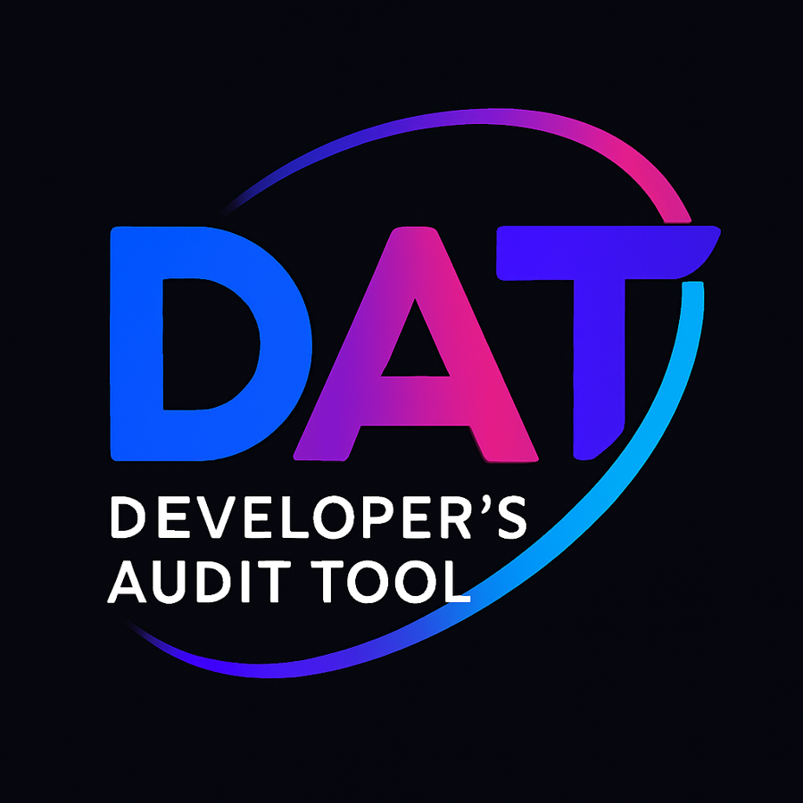

# DAT: Developer's Audit Tool

<p align="center">
  
</p>

DAT is the Outer Void ecosystem's independent **quality, security and release authority**. Every check is
deterministic: fixed rules over files, ASTs, manifests and archives. There is no AI judgment, no network
access and no telemetry. It runs on its own; BLUX, CogA and cA are optional consumers, never dependencies.

**Author:** Outer Void Team, Justadudeinspace · **Contact:** `outervoid.blux@gmail.com`

```sh
pip install "outervoid-dat @ git+https://github.com/Outer-Void/dat.git@v4.0.0"   # Python 3.11+, no dependencies
dat audit .                         # human report
dat release . --gate                # release gate (exit 1 on blocking findings)
dat security . --format json        # exactly one JSON document on stdout
dat artifact dist/ --sarif dat.sarif
```

From a checkout: `pip install -e .`, or `./scripts/install.sh --mode dev`.

## What it checks

| Capability | Command | Covers |
|---|---|---|
| `repo.audit` | `dat audit` | Everything below for a repository |
| `repo.security` | `dat security` | Secrets by exact token shape and guarded assignments, unsafe Python (AST), JS install scripts and `eval`, Android manifest flags and signing secrets, Dockerfile risks, unpinned VCS dependencies, insecure indexes |
| `repo.quality` | `dat quality` | Merge conflicts, Python syntax errors, bare `except`, leftover debuggers, work markers, large files, mixed line endings |
| `repo.release` | `dat release` | LICENSE/README/CHANGELOG, consistent versions, changelog entry, duplicate workflows, clean tree, version tag at HEAD, plus secrets and conflicts |
| `package.audit` | `dat package` | `pyproject.toml`, `requirements*.txt`, `package.json`: metadata, pinning, lockfiles |
| `artifact.audit` | `dat artifact` | Wheels, zips, tars, APK/JAR/AAR: path traversal, escaping links, setuid/devices, decompression bombs, wheel `RECORD` integrity, `SHA256SUMS`, secrets inside |
| `policy.verify` | `dat policy verify` | Validates a policy and re-gates a saved report |

The full rule catalog, with severities and confidences, is in [docs/FINDINGS.md](docs/FINDINGS.md).

## Findings are not failures

| Exit | Meaning |
|---|---|
| `0` | Audit completed; gate passed or not enforced |
| `1` | Audit completed; enforced gate failed |
| `2` | Usage error |
| `3` | DAT could not complete the audit (missing target, invalid policy, analyzer failure, limit, signing) |

In JSON this distinction is `outcome` (`completed` / `incomplete` / `error`), `gate.verdict` and a separate
`errors[]`. If one analyzer fails, the rest still run. The report says which one failed, and DAT exits `3`
instead of claiming a clean result.

## Reports

`text` (default), `json` (`dat.report` v1, [schema](src/dat/schemas/report.v1.schema.json)), `markdown` and
`sarif` (2.1.0, for code-scanning UIs). Reports are byte-for-byte reproducible and never contain secrets;
evidence is redacted (`AKIA…[REDACTED len=20]`). Findings carry a stable fingerprint for suppression and diffing.

## Configuration

A JSON policy at `.dat/policy.json` (or `--policy`) sets the gate threshold, severity overrides, reasoned
suppressions, ignore paths and limits ([docs/POLICY.md](docs/POLICY.md)). `.datignore` excludes paths.
`dat:ignore[rule.id]` on a line suppresses inline. Every suppression is listed in the report.

## Extending and integrating

- **Plugins:** subclass `dat.analyzers.Analyzer`, load with `--plugin` ([docs/PLUGINS.md](docs/PLUGINS.md)).
- **BLUX:** `.blux/` exposes all seven capabilities through `dat blux-capability`. Results are recorded in
  BLUX System and linked to the operation ([docs/BLUX.md](docs/BLUX.md)).
- **lrc:** `dat audit --report BUILD_DIR` and `dat --from-lrc DIR` keep working ([docs/USAGE.md](docs/USAGE.md#legacy-invocations-pre-40)).
- **CI:** `dat release . --gate --sarif dat.sarif`; see `.github/workflows/ci.yml`, which gates DAT on itself.

## Development

```sh
make install   # editable install with dev extras
make ci        # ruff, mypy --strict, pytest, wheel check, self-audit
```

What changed from 3.x and why: [CHANGELOG.md](CHANGELOG.md) and [docs/AUDIT-3.0.md](docs/AUDIT-3.0.md).

## Licence

MIT, see [LICENSE](LICENSE). The licence is unchanged by this rebuild; any change is an owner decision
tracked in the Outer Void credits ledger (UNR-008).
